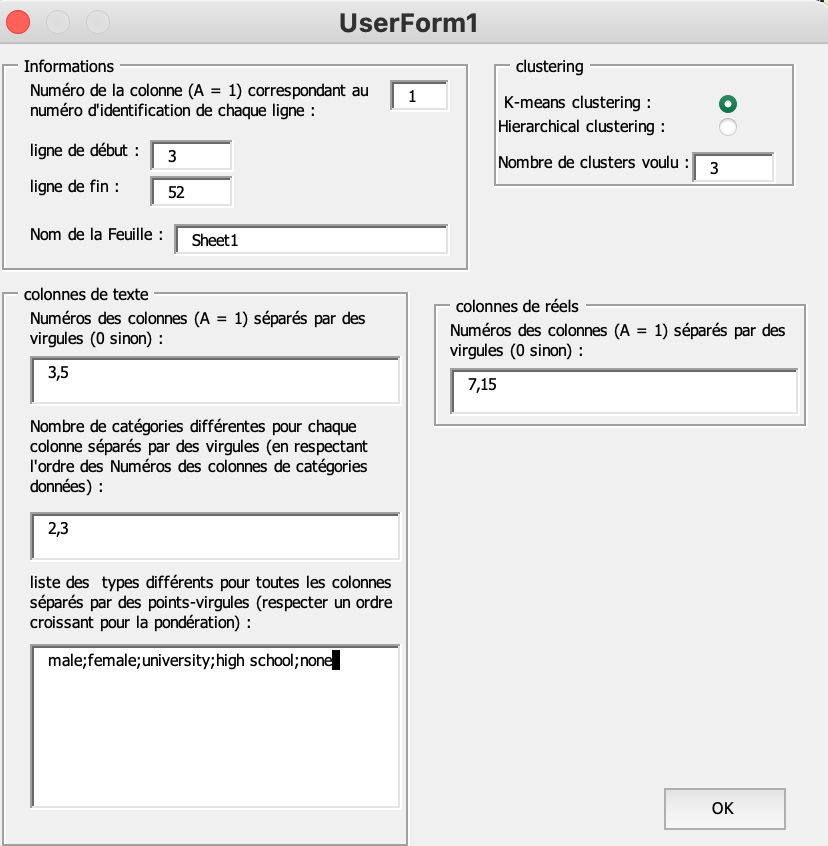

# Car Insurance Portfolio Segmentation with K-means and Hierarchical Clustering

VBA (Excel) implementation of K-means and hierarchical clustering to group similar policyholders.
A detailed description of the method is available in French: [rapport_clustering](docs/rapport_clustering.pdf).

## Motivation
Developed as a third-year undergraduate project (L3, ISFA) in VBA.

## Usage
1. Open `clustering.xlsm` and enable macros.
2. Go to Developer > Macros > `clustering` > Run.
3. Fill in the UserForm as shown below.

Note: a large number of rows can make the program slow.
